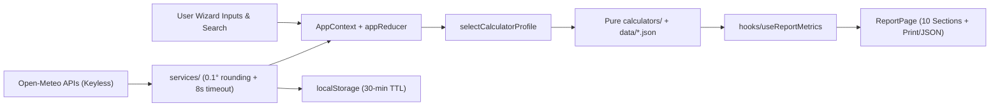

# SmogGuard Architecture

SmogGuard is designed as a **100% static, zero-secret React + Vite application** where all domain math runs deterministically in browser memory and all external requests go directly to keyless Open-Meteo REST endpoints.

---

## 1. Layered Module Boundaries

1. **`src/data/` & `src/constants/`**
   - Versioned JSON tables ([factors.json](../src/data/factors.json), [advisories.json](../src/data/advisories.json), [actions.json](../src/data/actions.json), [evidence.json](../src/data/evidence.json), [assumptions.json](../src/data/assumptions.json)) hold published emission factors, uncertainty bounds, and medical attribution strings.
   - `src/constants/` exposes typed domain constants (`INDIA_PM25_BREAKPOINTS`, `US_PM25_BREAKPOINTS`, `API_CONFIG`, `BOUNDS`, `TIME_UNITS`, `IMPACT_FACTORS`, `ROUTINE_DEFAULTS`).

2. **`src/calculators/` & `src/utils/` (Strictly Pure)**
   - **Zero** network calls, **zero** DOM APIs, **zero** `localStorage` access, **zero** side effects.
   - Modules:
     - `aqi.js`: Piecewise linear CPCB India NAQI & US EPA PM2.5 breakpoints, inverse AQI estimation, WHO 2021 (`15 µg/m³`) ratio, monitor calibration scaling.
     - `airWindow.js`: Sliding 3-hour window search identifying cleanest ventilation hours and worst smog avoidance hours.
     - `advisory.js`: MoHFW/NCDC guidance tailored to selected family profiles with non-medical disclaimer.
     - `exposure.js`: Heuristic 0–100 indoor exposure score and ranked pollution contributors.
     - `footprint.js`: 5-category annual CO₂e footprint (`transport`, `electricity`, `cooking`, `diet`, `waste`) with low/central/high ranges.
     - `purifier.js`: Room-by-room volume, CADR (`m³/h`), ACH, electricity cost/CO₂e, and Clean Room scoring.
     - `routine.js` & `routineSlots.js`: Priority-tier measure filtering (`do_now`, `today`, `this_week`, `later`) and 7-slot adaptive daily schedule.
     - `impact.js`, `impactDispatch.js`, `impactMobilityEnergy.js`, `impactHomeConsumption.js`: Per-action CO₂e/INR/payback calculations, category overlap scaling, and multi-mode ranker.

3. **`src/services/` (Browser Network & Cache Resilience)**
   - `geocodingClient.js`: `fetchWithTimeout` (8 s abort timeout), `AbortController` propagation, HTTP 429/5xx typed error mapping (`ApiRequestError`), and 2-character minimum place autocomplete.
   - `airCache.js`: Privacy-first `0.1°` (~11 km) coordinate rounding, 30-minute `localStorage` TTL caching, structured `StorageAccessError` corruption cleanup, and manual/sample fallback builders.
   - `openMeteo.js`: Orchestrates live Open-Meteo Air Quality + Weather requests and enforces the strict fallback chain:
     ```
     fresh 30-min cache -> live Open-Meteo -> stale cache (labeled with age) -> manual PM2.5 -> Sample Severe-Smog Demo
     ```

4. **`src/state/` (Single Source of Truth)**
   - `initialState.js`: Initial wizard schema and `selectCalculatorProfile` flattened selector.
   - `storagePersistence.js`: Safe `loadPersistedStateWithStatus` and `persistState` returning explicit `{ ok, error }` / `{ state, error }` objects without silent catches or `console` logging.
   - `sessionStore.js`: Pure `appReducer` handling wizard answers, monitor calibration, preferences, selected plan actions, JSON import merge, restart, and data erasure.
   - `AppContext.jsx`: React Context (`AppProvider` / `useAppStore`) syncing state changes to `localStorage` and applying `data-theme` (`dark`, `light`, `solid`) to `<html>`.

5. **`src/hooks/`, `src/components/`, & `src/pages/`**
   - Custom hooks (`useLocationSearch`, `useReportMetrics`, `useWizardController`) encapsulate debounced search state, memoized report calculations, and accessible step focus movement.
   - Components and pages stay focused on layout, ARIA roles, keyboard interactions, and readable markup.

---

## 2. Data & Control Flow



---

## 3. Privacy, Security & CSP Guarantees

- **Coordinate privacy:** `roundCoordinate` rounds coordinates to `0.1°` (~11 km) prior to any API call or cache key creation.
- **Content Security Policy:** `index.html` restricts `connect-src` strictly to `https://geocoding-api.open-meteo.com`, `https://air-quality-api.open-meteo.com`, and `https://api.open-meteo.com`.
- **Import safety:** `validateProfileImport` validates JSON structure and types before updating store state. Text inputs are sanitized via `sanitizeInput`.
- **User data control:** Settings provides full JSON export, validated JSON import, wizard restart (with confirmation), and full localStorage cleanup (`deleteAllData`).
